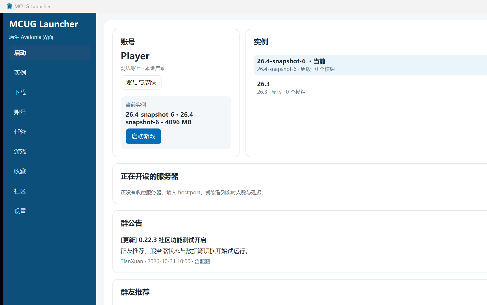
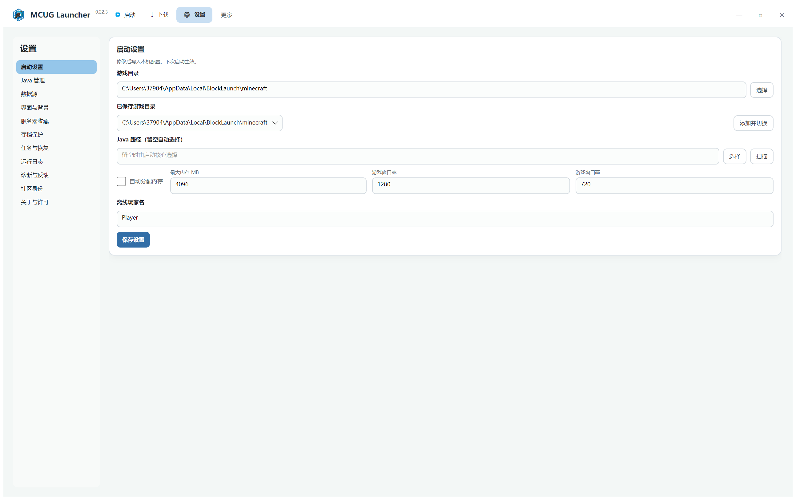

# MCUG Launcher 0.22.3

Windows 上的 Minecraft Java 版启动器。当前 0.22.3-Avalonia 分支使用原生 Avalonia 界面，
已接回启动、实例、下载、账号、任务、运行游戏、收藏、社区与设置等入口。WebView2 仅用于微软 OAuth
登录窗口；旧 Web UI 已移除。具体范围见 [原生 UI 迁移矩阵](docs/NATIVE_UI_PARITY.md)。

当前版本为 **0.22.3**。





界面布局与配色以 `0.22.3-fix` 的 Web 前端样式为基准：白色顶栏、浅灰绿画布、12px 卡片、
蓝色强调色、紧凑表单与分段导航；实现为原生 Avalonia 控件，不加载 Web UI。

## 0.22.3 更新重点

- **原生 Avalonia 界面**：左侧导航切换启动、实例、下载、账号、任务、游戏、收藏、社区与设置；
  蓝色主题、卡片式内容与可滚动布局，不再加载 HTML/CSS/JS 主界面。
- **版本选择面板**：点击「启动游戏」右侧的 `>`，游戏目录从右侧展开，可在「原版游戏 / FABRIC 版本」中直接选版本启动。
- **版本内容管理**：横向分类标签，模组表格支持更新、禁止更新、禁用、启动、删除；可切换当前实例。
- **模组下载链路**：「下载 → 模组」列表进入模组详情，支持安装到实例，或下载到自定义目录。
- **社区功能**：群公告、群友推荐、群友语录、正在开设的服务器。
- **设置**：匿名模式、社区身份密钥、管理员认证、四类独立数据源、写入接口。
- **公告配图**：管理员发布公告时可选择本地图片，随公告一起保存；配置写入接口后会一并提交。
- **账号**：离线账号直接进入游戏；皮肤 / 披风入口位于账号头像。

## 功能说明

### 主页

- 账号卡：正版 / 离线 / MUA 三个入口。正版走系统浏览器 OAuth，MUA 走账号密码 + authlib-injector，离线账号直接本地启动。
- 头像角标与悬停提示进入「皮肤与披风」面板。
- 「启动游戏」读取最后一个实例；右侧两个方形按钮分别是「选择实例」和「版本内容管理」。
- 右侧依次为：正在开设的服务器、群公告、群友推荐、群友语录。
- 服务器状态由启动器直接通过 MC Server List Ping 获取，8 秒超时；失败保留上一次结果。
- 公告 / 推荐 / 语录都支持加载、空、错误状态。

### 下载

- 页内导航：群友推荐、原版游戏、模组、整合包、资源包、光影、数据包。
- 群友推荐按服务器 / 材质包 / 光影切换。
- 官方分类已接入在线目录：原版游戏读取 Mojang 版本清单；模组 / 整合包 / 资源包 / 光影 / 数据包从 Modrinth 搜索，并可按当前实例版本筛选。
- 模组列表 → 模组详情：安装到实例，或下载到自定义目录。整合包仅下载 `.mrpack` 文件，不自动导入。
- 搜索结果需要联网；内容说明来自 Modrinth，暂不提供中文翻译。

### 实例

- 主页和「实例」页都可切换当前实例、直接启动或设为当前。
- 「实例」页包含内容、启动设置、维护三个页签：模组启停/删除、实例启动参数（可继承全局）、
  版本文件夹、克隆、导出、卸载预览与内容更新。

### 设置

- 启动设置：游戏根目录、Java 路径、最大内存、游戏窗口宽高；可保存、选择路径。
- Java 管理：按本机 PATH、JAVA_HOME、常见安装目录查找 `java.exe`，列出路径后可选用；不会自动修改游戏版本。
- 下载与网络：查看四类数据源、跳转数据源设置、打开游戏目录。
- 界面与背景：固定蓝白主题；恢复默认窗口尺寸。
- 社区：更多选项、管理员、数据源。
- 服务器收藏：查看收藏服务器、重新 ping、管理或添加。
- 存档保护：一键打包 `saves` 到本地备份目录，或打开存档文件夹。
- 下载任务：持久队列，支持暂停、继续、取消与删除；关闭页面不影响任务。
- 任务与恢复：恢复窗口尺寸、打开配置目录与游戏目录。
- 运行日志：读取最近 400 行日志，打开日志目录。
- 诊断与反馈：读取 .NET / WebView2 / 系统 / 路径信息并复制。
- 关于与许可：版本、社区数据仓库、管理员文档入口。
- 社区 → 更多选项：匿名模式、社区身份密钥。
- 社区 → 管理员：未设置时首次输入即设置本机管理员密钥；之后必须输入同一密钥才能发布公告。
- 社区 → 数据源：四类 URL 独立配置、逐项测试、保存、恢复默认、可选写入接口。

## 数据源

四类数据分别读取独立 JSON：

| 类型 | 示例文件 | 主要字段 |
| --- | --- | --- |
| 公告 | `community/announcements.json` | `id, title, body, tag, author, publishedAt, expiresAt, imageUrl?` |
| 服务器 | `community/servers.json` | `id, name, address, description, version, mode, tags, icon` |
| 推荐 | `community/recommendations.json` | `id, type(server/material/shader), name, author, description, tags, version, size, url` |
| 语录 | `community/quotes.json` | `id, type(text/image), text, author, source, imageUrl?, created_at` |

默认地址集中在 `Models/AppConfig.cs` 的 `DataSourceConfig`，当前指向 `waibibabu1239/MCUGL-storage`。首次使用的旧配置不会自动覆盖；如仍指向示例仓库，请在「设置 → 数据源」点「恢复默认」再保存。

- 读取超时 8 秒；单个地址失败不会阻塞其他区块。
- 管理员写入接口可选；未配置时公告只保存在本机，并显示「待发布」。
- 公告配图以 data URL 保存/提交；如果写入接口有对象存储，建议在服务端转存并替换为图片 URL。
- 管理员认证、删除边界与 GitHub 托管步骤见 [docs/admin-and-community.md](docs/admin-and-community.md)。

本轮继续接回实例克隆、整合包 ZIP 导出、卸载路径预览和内容更新预览；结构与格式检查结论见 [代码风格复查](docs/CODE_STYLE_REVIEW.md)。

## 技术架构

```
Avalonia 原生窗口 (ShellWindow + Views/*View)
        │  ILauncherService（App/Contracts 共享契约）
        ▼
UseCases / Services（账号、版本、任务、社区、配置）
        ▼
MCUGLauncher.Core（下载校验、依赖解析、实例与启动）
```

WebView2 只保留在微软 OAuth 登录窗口中，不参与主界面渲染。后端组件的分级、依赖声明与 Core
下沉规则见 [BACKEND_DEVELOPMENT.md](BACKEND_DEVELOPMENT.md)。当前架构与迁移状态见
[架构说明](docs/ARCHITECTURE.md) 与 [原生 UI 迁移矩阵](docs/NATIVE_UI_PARITY.md)。

### 目录

```
src/MCUGLauncher.Avalonia/   原生 Avalonia 窗口、Views 页面与微软登录窗口
src/MCUGLauncher.App/        UseCases、Services、Authentication、配置模型
src/MCUGLauncher.Core/       启动核心（下载、Java、实例、整合包）
test/                        行为、兼容与 LauncherChecks
community/                   数据源示例 JSON
docs/images/                 README 截图
artifacts/full/              完整版发布产物
artifacts/lite/              轻量版发布产物
```

## 运行要求

- Windows 10 / 11 x64。
- **WebView2 Runtime**：仅微软 OAuth 登录窗口需要（Windows 11 通常已内置；Windows 10 如缺失需安装 Evergreen Runtime）。
- 完整版：无需安装 .NET。
- 轻量版：需要 **.NET 8 Desktop Runtime x64**。

| 版本 | 产物 |
| --- | --- |
| 完整版 | `artifacts/release/MCUGLauncher-0.22.3-Windows-x64.zip`（解压后运行 `MCUGLauncher.exe`） |
| 轻量版 | `artifacts/release/MCUGLauncher-0.22.3-Windows-x64-Lite.zip` |

## 构建

```powershell
dotnet build MCUGLauncher.sln -c Release
```

## 发布

```powershell
.\scriptsuild.ps1 -Publish
```

脚本发布 `artifacts/full`（自包含）与 `artifacts/lite`（依赖 .NET 8 Desktop Runtime），再打包为两个 zip 放到 `artifacts/release`。

单文件版本（可选）：

```powershell
.\scriptsuild.ps1 -Publish -SingleFile
```

产物为 `artifacts/release/MCUGLauncher-0.22.3-Windows-x64.exe` 与 `-Lite.exe`。单文件启动时会把原生库解压到 `%TEMP%\.net`，该目录不可写会以 `error 160` 退出；清理 `%TEMP%\.net` 或改用默认的 zip 发布。

> 发布不再使用单文件 EXE：单文件 apphost 需要把原生库解压到 `%TEMP%\.net`，该缓存不可写时 EXE 会以 `error 160` 退出。若仍遇到旧包，删除 `%TEMP%\.net` 后重试。

## 本地数据

- 配置：`%LOCALAPPDATA%\MCUGLauncher\config.json`
- 界面缓存：`%LOCALAPPDATA%\MCUGLauncher\ui-0.22.3\`
- WebView2 数据：`%LOCALAPPDATA%\MCUGLauncher\WebView2\`
- 本地公告：`%LOCALAPPDATA%\MCUGLauncher\announcements.local.json`
- 本地推荐：`%LOCALAPPDATA%\MCUGLauncher\recommendations.local.json`
- 账号令牌：`%LOCALAPPDATA%\MCUGLauncher\auth\`

首次启动会尝试从 0.22.2 的 `%LOCALAPPDATA%\BlockLaunch\settings.json` 导入游戏目录、玩家名、Java、内存、窗口尺寸和收藏服务器。

## 已知限制

- 微软登录使用系统浏览器完成 OAuth；MUA 使用账号密码并注入 authlib。两项都需要真实账号和网络，当前环境未做真实账号联调；失败时会回到离线账号。
- 皮肤 / 披风面板目前只有入口与预览，选择操作尚未接入皮肤站上传与外层渲染。
- 资源包 / 光影 / 存档 / 截图 / 蓝图标签显示 0，尚未实现目录扫描。
- 版本设置中的「修改版本名 / 补全文件」等按钮是界面占位，启动、打开文件夹、切换实例、版本内容管理已可用。
- 群友推荐只有推荐列表；下载跳转依赖 JSON 中的 `url`。
- 0.22.3 不含自动更新。

管理员认证、公告发布和 GitHub 数据托管见 [docs/admin-and-community.md](docs/admin-and-community.md)。

## 变更记录

见 [CHANGELOG.md](CHANGELOG.md)。

## 许可

本项目未附带新的开源许可证；发布前请沿用原仓库的许可策略。


