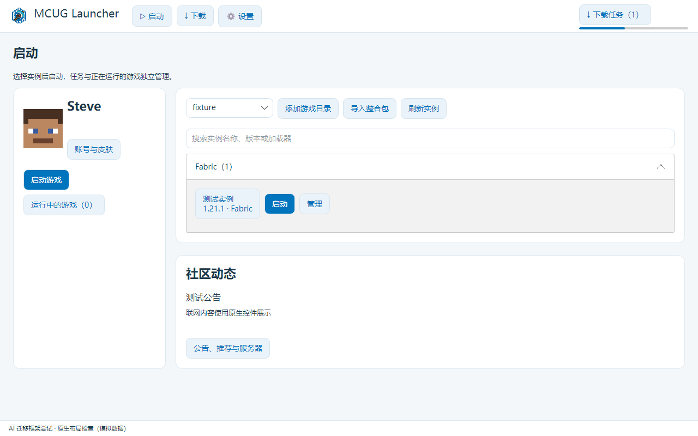

# MCUG Launcher · 0.24.0-codex

**AI 迁移框架尝试**：把启动器主界面从 HTML/CSS/JS + WebView2 改成 Avalonia 原生控件。本分支是实验性迁移，未发布 Release，不代表真实账号和所有游戏环境已经验收。

当前版本为 **0.24.0**，实验频道为 `codex`。



## 来源与范围

基于远端 `0.22.3-Avalonia` 的 App/Core 分层与认证适配，补齐原生页面，移除旧主界面和网页回退。包含 `0.22.3-codex` 的账号缓存、自定义启动参数、数据源保存与启用分离等行为。没有合入用户提供的 `0.24.0-deepseek.zip`，也没有改动 `0.23.x` 或其他远端分支。

- 启动：账号、目录、实例筛选、实例启动、社区动态。
- 下载：原版、加载器、模组、整合包、资源包、光影、数据包；选择实际版本和固定目标后加入原 Core 队列。
- 设置：账号与皮肤、Java、全局和单实例启动参数、实例与模组管理、存档、服务器、收藏、数据源、任务、运行游戏、诊断和本地公告编辑。
- 默认源 / 自定义源：进入页签自动测试；保存不启用，单独使用按钮显示当前状态；不显示写入接口栏。
- 保留 MCUG 透明标志和蓝白配色，分类图标可在 `NavigationCatalog` 的 `IconPath` 中替换成资源图片。

微软官方授权页面仍放在独立的 Avalonia 登录窗口中，使用 WebView2 展示第三方网页；它不是旧主界面的回退。启动器其他页面不使用浏览器。当前仍只支持 Windows x64，不宣称已实现跨平台。

## 构建与检查

需要 `global.json` 指定的 .NET SDK。

```powershell
dotnet build src/MCUGLauncher.Avalonia/MCUGLauncher.Avalonia.csproj -c Release
python scripts/check-layout.py
python scripts/check-web-boundaries.py
python scripts/check-version.py
dotnet run --project tools/SourceFormatter
./scripts/run-checks.ps1 -Name MuaChecks,DownloadChecks,QueueChecks,CompatibilityChecks,WebBridgeChecks,NativeUiChecks
```

原生界面检查使用 Avalonia Headless + Skia，模拟应用响应并输出三档布局截图。这些检查不代替真实 Microsoft/MUA 登录、文件选择对话框和 Minecraft 验收。

## 目录

- `src/MCUGLauncher.Core`：复用的启动、下载、校验、实例能力。
- `src/MCUGLauncher.App`：无 WPF/Avalonia 控件的应用用例、认证和配置服务。
- `src/MCUGLauncher.Avalonia/Presentation`：类型化界面契约和菜单注册。
- `src/MCUGLauncher.Avalonia/Views`：分功能原生视图与对话框。
- `LauncherFacade`：原生状态与现有用例之间的适配；内部保留 JSON 命令兼容层。
- `test/NativeUiChecks`：原生控件交互与渲染检查。

详细范围、限制与验证见 [迁移说明](docs/MIGRATION_0.24.0-codex.md)。

开发须遵循 [AGENTS.md](AGENTS.md) 与 [交付流程](docs/DEVELOPMENT_WORKFLOW.md)。本地测试版按分支名命名，保存文档、检查风格、推送分支和更新 Lite 均属于交付步骤。
